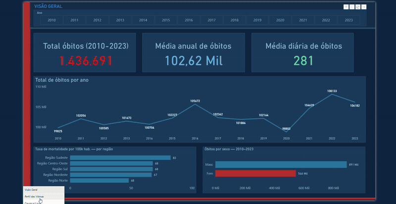
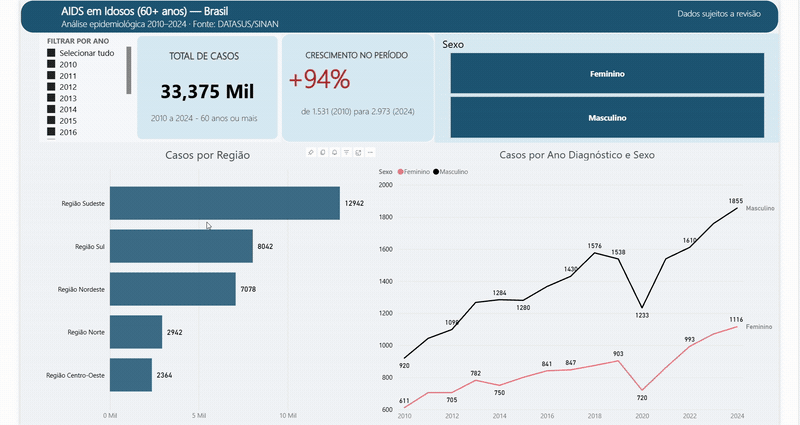

# Oi, eu sou o Kaike 👋

---

Estudante de Ciência de Dados na FMU São Paulo, no segundo semestre, mas já construindo portfólio com projetos reais desde o início. Antes de entrar na área, passei 3 anos como Analista de Vendas numa empresa, onde aprendi que dados sem contexto de negócio não valem muito. Esse ponto de vista guia tudo que faço.

Tenho foco em **dados públicos de saúde** coleta, preparação e análise de bases como DATASUS e IBGE, do dado bruto até a resposta de negócio. Cada projeto que publico aqui nasceu de uma pergunta real, não de um tutorial.

---

## 📂 Projetos em destaque

### ❤️ [Mortalidade Cardiovascular em Adultos de 15–64 anos no Brasil (2010–2023)](https://github.com/kaike-martins/cardiovascular-adultos-brasil)

1.436.691 óbitos analisados ao longo de 14 anos. Infarto lidera com 31,7% das mortes, homens morrem 1,63x mais que mulheres, e 24,8% dos óbitos ocorrem fora do hospital. Dashboard de 4 páginas no Power BI com esquema estrela e medidas DAX. Co-autoria científica em andamento.

`Excel` `Power Query` `Power BI` `DAX` `PowerPoint` `SIM/DATASUS`

---

### 🔬 [AIDS em pessoas com 60+ anos no Brasil (2010–2024)](https://github.com/kaike-martins/aids-60anos_mais-brasil)

Análise epidemiológica sobre o crescimento dos casos de AIDS entre idosos brasileiros. 33.375 casos, crescimento de 94% no período, e evidências de interiorização da epidemia para Norte e Nordeste. Artigo submetido ao CONIC-SEMESP 2026, em co-autoria.

`Excel` `Power Query` `Power BI` `PowerPoint` `DATASUS/SINAN`

---

### 🧪 [Coleta e Preparação de Dados em Saúde — Zika (SP) + IBGE](https://github.com/kaike-martins/coleta-preparacao-dados-saude)

Projeto de engenharia de dados: coleta de duas fontes de naturezas diferentes (arquivo do DATASUS/TabNet e API do IBGE), tratamento de problemas reais de qualidade (codificação, separador, JSON aninhado), padronização de chave entre as bases e integração por *join*. Foco no que acontece antes da análise — garantir que o dado seja confiável.

`Python` `Pandas` `requests` `DATASUS/SINAN` `API IBGE`

---

## 🎓 Jornada acadêmica

**Ciência de Dados** — FMU São Paulo *(2026 → em andamento)*
2º semestre. Cursando Banco de Dados Relacional (SQL), Aquisição e Preparação de Dados, POO em Java e Cálculo Aplicado. Representante de turma.

**Programação com Python** — FMU São Paulo *(Abr/2026 · 40h)*
Fundamentos de Python: lógica, estruturas condicionais, listas e manipulação de arquivos CSV.

**AI Fluency: Framework & Foundations** — Anthropic Academy *(Abr/2026)*
Framework 4D para colaboração eficaz com sistemas de IA, ética e uso responsável.

**Comunicação Assertiva Aplicada a Vendas** — Senac PR *(Jun/2024)*
Técnicas de comunicação com clientes e argumentação em contextos comerciais.

---

## 📬 Onde me encontrar

Atualmente **buscando estágio em dados / BI**. Aberto a conversas e oportunidades.

